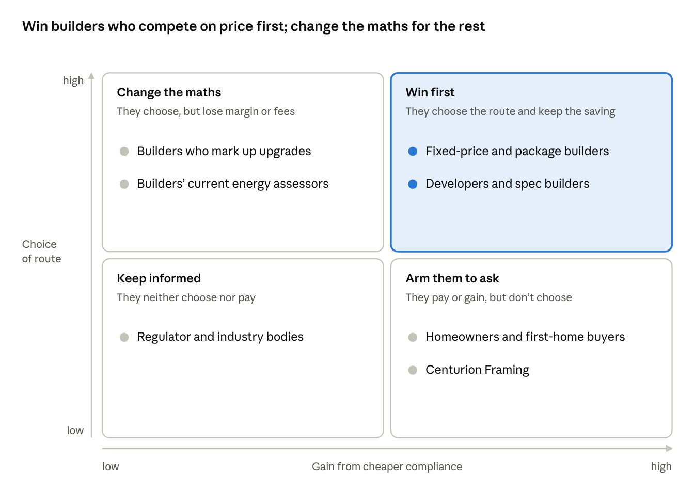
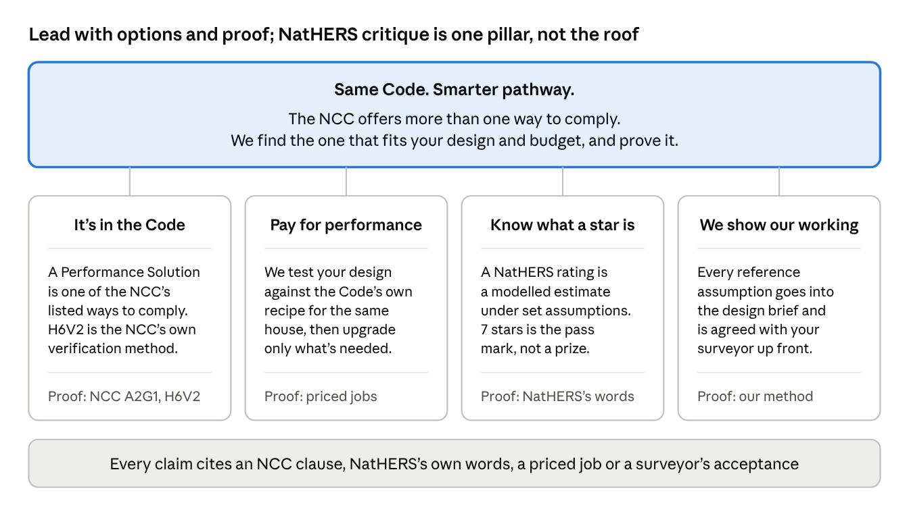
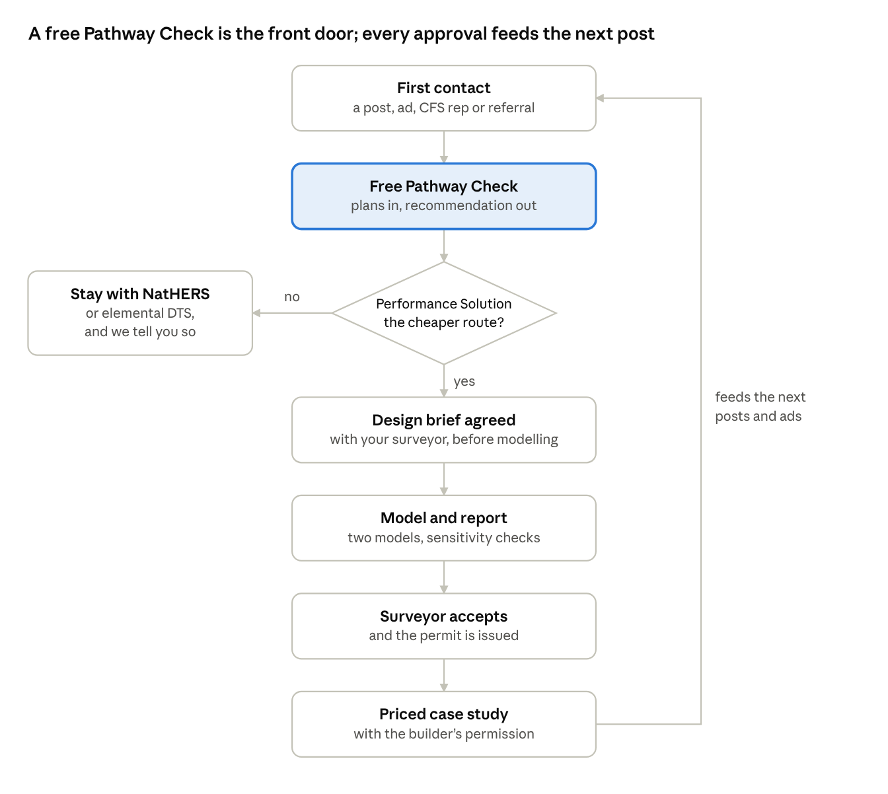
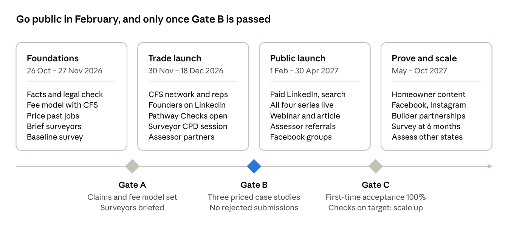

# Performance Solutions Awareness Strategy

_Exported on 22 Oct 2026 from the live doc at https://claude.ai/artifact/MoYR2R8RcQK9oUvn4JsM6d, which is the working version._

Oct 22, 2026 · @Alistair

Lead with the Code, not an attack on NatHERS. Show builders the NCC offers more than one valid way to comply, prove the savings on real jobs, and use NatHERS's own words on what a star rating measures.

The harder problem is incentives: many builders earn margin on 7-star upgrades, and a Performance Solution costs about ten times a NatHERS rating. So start with builders who compete on price, take the fee risk off the rest, and give homeowners the question to ask. Brief surveyors and Centurion Framing's network first; go public once approved case studies exist.

Ready-to-adapt posts, scripts and copy are in [Draft content](Performance_Solutions_draft_content.md).

## What we're up against

Builders aren't choosing NatHERS; they're defaulting to it. Around nine in ten new homes take the NatHERS route, and the belief that the alternative is a loophole has a real history the campaign must answer, not ignore.

| What builders believe | What the rules actually say | Where |
| --- | --- | --- |
| NatHERS 7 stars is the only way to comply | The Performance Requirements are the mandatory part of the NCC. They are met by a Performance Solution, a Deemed-to-Satisfy Solution, or a combination. For a house, a NatHERS rating is one Deemed-to-Satisfy option for thermal performance (H6P1); the elemental provisions are another; H6V2 verifies a Performance Solution. | NCC 2022 Vol Two A2G1(2), H6D2, H6V2 |
| 7 stars is the gold standard | 7 stars is the minimum for the NatHERS option. The ABCB says "all compliance options aim to offer an equivalent level of performance". | ABCB Housing energy efficiency handbook (2024), pp 10 and 111 |
| A Performance Solution is a loophole | It carries more process, not less: a performance-based design brief prepared with stakeholders, analysis, evaluation against acceptance criteria, and a final report. WA's regulator: it "is not a mechanism for accepting non-compliance… rather it is a pathway for demonstrating compliance". | NCC A2G2(4); WA Industry Bulletin 102 |
| The surveyor won't accept it | In WA a registered building surveyor approves a Performance Solution when issuing the Certificate of Design Compliance, and the permit application must list each one. Involving the surveyor in the design brief is how acceptance is won. | WA Industry Bulletin 102; Building Regulations 2012 r 16(3)(c) |

Why the beliefs persist:

- **Habit.** NatHERS is what assessors are accredited to deliver and what builders already know.
- **History.** In 2017 The Conversation and the ABC reported builders using the older reference-building method to pass houses "well short of the six-star standard". The ABCB then called that method "too flexible", barred NatHERS software from it in 2019, and fixed its heating and cooling schedules, thermostat settings and occupancy in NCC 2022. Critics remember 2017, so show what changed.
- **Scrutiny.** WA's Building and Energy regulator has energy efficiency in its 2025–26 audit focus, so surveyors will be cautious with anything unfamiliar.
- **No side-by-side prices.** Few builders have ever seen the same house priced both ways.

In WA, the NCC 2022 energy provisions (7 stars and whole-of-home) have applied to permit applications since 1 May 2025, with a WA variation that removes the separate NatHERS heating and cooling load limits. NCC 2025, released 1 May 2026 and mandatory in WA from 1 May 2027, keeps Part H6 and H6V2 substantively unchanged. The Commonwealth has also said there will be no further residential NCC changes, other than essential quality and safety measures, until mid-2029, so the rules this campaign explains should hold until then.

## Who pays, who decides

The homeowner pays for 7-star upgrades but rarely chooses the pathway. The builder chooses, often earns margin on the upgrades, would carry a fee about ten times a NatHERS rating's, and is usually loyal to an existing assessor.

So win the builders whose incentives line up first, change the maths for the rest, and never ask anyone to switch assessor.

Surveyors sit outside this map: they don't choose the route, but they can stop it, which is why they are briefed first.

| Group | Lever | Line to use |
| --- | --- | --- |
| Fixed-price and package builders; developers and spec builders | A free Pathway Check on their standard plans, then standard-plan pricing | "Quote lower and win more jobs." |
| Builders who mark up upgrades | Move the client's budget rather than cut it: money not spent on compliance can go on features the client wants, which the builder also prices | "Put your client's money into the kitchen, not the compliance." |
| Builders' current energy assessors | Partner, don't replace: a referral or white-label arrangement for designs that struggle to reach 7 stars, so the assessor keeps the client and the NatHERS work | "Send us the jobs where the upgrade list hurts." |
| Homeowners and first-home buyers | Content and search ads aimed at the moment a quote arrives | "Got a 7-star upgrade line in your quote? Ask whether the pathways were compared." |
| Centurion Framing | Opens doors to its builders, and could fund part of the fee on CFS-framed homes, disclosed | "Before you upgrade, compare the pathways." |
| Regulator and industry bodies | A published method and constructive submissions | None: no campaign lines |

**The fee gap.** On Thermarate's figures, a NatHERS assessment costs a builder about $200 and a Performance Solution about $2,000. For the homeowner, the Performance Solution pays once it removes more than about $1,800 of upgrades, plus any margin added to them.

Published Perth estimates put the whole 6-to-7-star upgrade at $4,262 to $7,179 per house, so break-even is plausible on many jobs. Only priced jobs will show how often.

Take the fee risk off the builder:

- **Pathway Check first.** The builder sees the likely net saving before paying anything.
- **One job, not a switch.** Ask builders to try it on one job where they already hold a NatHERS report with a painful upgrade list. Their assessor stays their assessor.
- **A savings condition.** Charge the full fee only when the check shows a net saving of at least \[twice the fee\]; otherwise say so and charge nothing. Put the condition in writing.
- **Let the beneficiary pay.** Show the fee on its own line beside the upgrades it removes, so the homeowner sees the net.
- **Standard-plan pricing.** Pre-model a package builder's standard plans so the per-lot fee falls.
- **A CFS contribution.** CFS covers part of the fee on CFS-framed homes, disclosed on every offer.

Never say in public that builders profit from upgrades. Marking up materials is ordinary pricing, CFS's customers are builders, and the line would cost you both the channel. Let the side-by-side numbers make the point.

## The savings case

Savings are the hook, but no independent study of H6V2 savings has been published, so every dollar figure in the campaign must come from Thermarate's own priced jobs. Until those exist, claim the mechanism, not the amount.

The mechanism: H6V2 compares a design with the Code's own Deemed-to-Satisfy version of the same house, not with a fixed star band. Where that benchmark is easier to meet than 7 stars for a particular design, fewer upgrades are needed. Where it isn't, NatHERS stays the cheaper route, and the Pathway Check says so.

Published estimates of what 7 stars costs, for context only (none is a Thermarate claim):

| Source | Estimate | Caveat |
| --- | --- | --- |
| HIA, Perth base house (reported by TBB Planning) | About $7,179 extra per dwelling, saving about $310 a year in energy | Builders' lobby estimate, seen only second-hand |
| Graham Energy for the Australian Glass and Window Association (Sept 2024) | Perth average of $4,262 to go from 6 to 7 stars | Paid for by the window industry; building shell only; least favourable orientation |
| HIA consultation submission (2021), national | $13,257 per dwelling for the option later adopted for houses | Estimate made before adoption |
| ABCB Decision Regulation Impact Statement (2022) | WA figure in its Table 6.1 | Extract it before quoting any official number |

The $15,000 in the CFS example graphic is about twice the highest Perth estimate found, so it cannot run without Thermarate's own data behind it.

**Say now:** a Performance Solution is a legitimate NCC route; on some designs it needs fewer upgrades than the 7-star route; the free Pathway Check shows which route is likely cheaper for your plans.

**Not yet:** any dollar saving or average, "no extra cost", "the same performance as 7 stars", or payback periods.

Build each case study the same way:

1. Same plans, specified both ways: a 7-star NatHERS specification from an independent assessor, and Thermarate's H6V2 specification.
2. The builder's own prices for both, plus every fee on each route (assessor, Thermarate, surveyor).
3. The surveyor's written acceptance of the Performance Solution.
4. The builder's sign-off on the saving, and permission to publish with client details removed.
5. Results published as a range across jobs, including the ones where NatHERS was cheaper.

Keep that file for every number you publish. A promise of future savings is treated as misleading unless you can show reasonable grounds for it (ACL s4), and the ACCC can demand the evidence within 21 days (ACL s219).

## Your four NatHERS points, checked

Lead with point 2, use point 4 selectively and point 3 carefully, and drop point 1 as worded: it is wrong, and it is the line most likely to draw a complaint.

Since 1 July 2026 NatHERS has a new public name, Home Energy Rating, and new-home certificates read "Home Energy Rating (NatHERS)". Use both names so readers recognise it.

| Your point | Verdict | What the evidence shows | Say this instead |
| --- | --- | --- | --- |
| 1. NatHERS is a business that earns money from issuing certificates | Wrong as worded. Drop it | NatHERS is a joint scheme of the Commonwealth, state and territory governments, administered by DCCEEW; no fee to the Administrator was found. Money does flow around it: each certificate carries a software fee of roughly $27–45 plus GST, including a royalty of about $13 to CSIRO (a government agency) for its rating engine. FirstRate5 is owned by the Victorian Government. Assessors charge for their work. | "Around nine in ten new homes go the NatHERS route. That's habit, not law. Ask your assessor which pathways they can deliver." Then disclose your own interest: "We deliver Performance Solutions, so we'll also tell you when NatHERS is cheaper." |
| 2. The star rating isn't what consumers think it is | True. Lead with it | NatHERS's own pages say a rating estimates how much heating or cooling a home needs to stay comfortable, using standard assumptions about occupants and thermostat settings. Appliances aren't counted, apart from ceiling-fan air flow, and actual use "may vary" because the assumptions won't match how people live. They call 7 stars "the minimum standard for new houses under the National Construction Code 2022". | "A star rating is a modelled estimate of the heating and cooling a design needs, under standard assumptions. NatHERS says real use will differ. And 7 stars is the minimum, not a medal." |
| 3. The outputs rest on questionable assumptions | Partly true, but it cuts both ways | Studies found NatHERS's occupancy assumptions don't match how monitored households heat and cool (Daniel, Soebarto and Williamson 2015), and ratings correlated poorly with measured performance in five award-winning houses (Williamson, Soebarto and Radford 2010). Other studies found higher-rated homes do use less energy (CSIRO 2013; O'Leary and others 2016). H6V2 runs the same kind of simulation, with fixed thermostat settings, schedules and occupancy. | "Every compliance model rests on standard assumptions, ours included. The real question is whether the benchmark is fair for your design." Never "the ratings are wrong". |
| 4. Many more issues | Use only those with evidence | Usable with care: a rating checks the design, not the finished house (measured air-tightness can't be used in a regulatory rating for new homes), and predicted heating and cooling energy per new dwelling rose 10.4% from 2018 to 2022 even though minimum standards were met (Wingrove, Heffernan and Daly 2024, 580,956 certificates). Don't use "ratings bear no relation to energy use" or "new homes are leakier than NatHERS assumes": both are contradicted by CSIRO's work. | "A rating checks the design, not the build. If performance matters to you, test the finished house." |

On steel frames: CSIRO's thermal-bridging modelling for NCC 2022 found ratings fell in most climate zones once bridging was counted, "especially with metal framed construction". That makes 7 stars genuinely harder for steel-framed houses and is a fair reason to compare pathways. It is not evidence that NatHERS treats steel unfairly, so don't say it does.

## Positioning

Position Thermarate as the specialist that tests a design against the Code itself, not against a star target. The promise in four words: **Same Code. Smarter pathway.**

For WA builders and designers who want energy compliance at the lowest sound cost, Thermarate is the Performance Solution specialist that models your design against the Code's own Deemed-to-Satisfy version of the same house, upgrades only what's needed, and documents it so your surveyor can say yes.

Critique of NatHERS lives in one pillar, framed as education and sourced to NatHERS itself. It never carries the headline.

Tagline options:

- **Same Code. Smarter pathway.** Recommended: it pairs legitimacy with the benefit.
- **It's not a loophole. It's in the Code.** Best for the myth-busting series.
- **7 stars is one way to comply. It isn't the only way.**
- **Comply with the Code, not the habit.**

Tone: calm, exact and a little contrarian. Plain words, short sentences and a clause behind every claim; confident about the Code, respectful of NatHERS and the assessors who use it.

If Thermarate can also deliver NatHERS ratings, or quote one through a partner, say so. An adviser who offers both routes is more credible than a seller of one.

## Audiences

Win the gatekeepers before the crowd. Building surveyors and Centurion Framing Systems' (CFS) steel-frame builders come first; homeowners come last, once there are approved case studies to show them.

| Audience | Believes now | Needs to believe | What moves them | Reach and timing |
| --- | --- | --- | --- | --- |
| Building surveyors (private and local government) | An energy Performance Solution is unfamiliar, slow to assess and a liability risk; a reference building can be gamed | A Thermarate submission is complete, conservative and quick to assess | A standard design-brief template, a published modelling method, sensitivity checks, one technical contact | One-to-one briefings and a CPD session. First, before any public content |
| Fixed-price, package and spec builders, starting with CFS's network | NatHERS 7 stars is the only route; anything else risks a knock-back | A second legal route can lower their price on the same plans, and Thermarate handles the paperwork | Priced side-by-side jobs on houses like theirs; a surveyor who has accepted one; a free check on their standard plans | CFS reps, newsletters and events; LinkedIn. First |
| Builders who mark up upgrades (custom, cost-plus) | Upgrades are the client's cost, while a dearer assessment is theirs | The client's budget is better spent on features than on compliance, and a lower price wins jobs | The fee shown beside the upgrades it removes; one job, not a switch of assessor | LinkedIn, HIA and Master Builders WA events, and their clients' questions. From February 2027 |
| Building designers and drafters | Energy is an upgrade list that arrives after the design is done | Choosing the pathway at concept stage protects the design | Before-and-after examples where the glazing and layout survived | BDAWA events, LinkedIn, CPD. From February 2027 |
| Builders' current energy assessors | Performance Solutions are a rival product or a loophole | Referring a design that struggles to reach 7 stars keeps their client and their NatHERS work | A referral or white-label arrangement, and a respectful tone | Direct outreach. From December 2026 |
| Homeowners and first-home buyers | 7 stars means a good house; anything else is second best | Both routes meet the same legal requirement, and they can ask whether the pathways were compared | Plain-English explainers that quote NatHERS itself, aimed at the moment a quote arrives | Search ads from February 2027; Facebook and Instagram from May |
| WA regulator and industry bodies | Neutral to wary | Thermarate raises compliance standards rather than cutting corners | A transparent method, constructive submissions, no attacks on the scheme | Meetings and consultations. Ongoing |

Surveyors matter most. A builder who hears the message and then has a submission knocked back becomes the campaign's loudest critic.

## Campaign and channels

Run one campaign, working title **It's in the Code**, through four content series. LinkedIn and the CFS network carry it to the trade, search catches builders when a design fails 7 stars, and Facebook and Instagram reach homeowners once case studies exist.

Every piece makes one point and names its source: an NCC clause, NatHERS's own words, or a priced Thermarate job.

| Series | Job | Example | Formats |
| --- | --- | --- | --- |
| It's in the Code | Show the route is written into the NCC | "The NCC's energy rules for houses can be met by a Performance Solution or a Deemed-to-Satisfy Solution. A NatHERS rating is one option inside the second." | Single-image posts, carousels |
| Same house, two pathways | Prove the savings on real, priced jobs | "Perth, climate zone 5, steel frame and brick veneer: what the 7-star route needed, what the Performance Solution needed, and what each cost" | Carousel, one-page PDF, 60-second video |
| What's in a star? | Explain what a NatHERS rating does and doesn't measure | "A star rating is a modelled estimate made under standard assumptions. It isn't a meter reading." | Carousels, reels, homeowner ads |
| Ask the modeller | Answer objections in Alistair's or Fraser's own voice | "Will my surveyor accept it?" | 60-second videos, text posts |

| Channel | Job | Starts |
| --- | --- | --- |
| LinkedIn: Alistair's and Fraser's profiles, plus the Thermarate page | The main trade channel. The founders post; the page and CFS reshare | November organic; paid targeting of WA builders, designers and surveyors from February |
| CFS network | A trusted introduction to steel-frame builders: newsletter items, rep talking points, co-hosted breakfasts | November |
| Google search and a landing page | Catch builders searching after a failed rating or a big upgrade quote; every ad leads to the free Pathway Check | February |
| CPD and events | Surveyors (AIBS), designers (BDAWA), builders (HIA, Master Builders WA, CFS breakfasts) | November for surveyors, then quarterly |
| Facebook | Builder and owner-builder groups (within group rules), retargeting, then homeowner explainers | February; homeowners from May |
| Instagram | Visual explainers for homeowners, recut from the LinkedIn material | May |
| Trade media | Technical articles and survey results that make the case on neutral ground | March onwards |

Pete's email proposes LinkedIn, Instagram and Facebook. Add search, CPD and direct surveyor briefings to The Marketing Room's brief: social reach creates interest, but surveyor confidence and a clear next step turn it into jobs.

## From post to project

Every channel points to one offer: a free Pathway Check. It tells a builder which compliance route is likely to cost least for their plans, including when the answer is NatHERS.

Telling a builder to stay with NatHERS when that is cheaper is part of the offer. It proves the advice is real, and it earns the next referral.

- **What the builder sends:** plans, elevations, specification, location, and any NatHERS report or upgrade quote they already hold. A job with a painful upgrade list is the best first job, and the builder keeps their assessor.
- **What they get back:** the likely cheapest compliant route, the upgrades each route needs, the net saving after every fee, and the surveyor steps.
- **Turnaround:** publish a number of business days you can always meet. Cap free checks per week if capacity is tight, and give CFS-network builders priority in the trade launch.
- **Fee:** one of the options in Who pays, who decides, settled before the trade launch.
- **After every job:** ask permission to publish a priced case study with client details removed, and record the saving the builder confirms.

## Rollout

Build proof before reach: five weeks of foundations, a trade launch through CFS and surveyors before Christmas, then the public launch in February 2027 once Gate B is passed.

Each gate is a go/no-go check. If its criteria aren't met, extend the phase before it rather than spending more on reach. The industry's summer shutdown (late December to mid-January) is the natural break between the trade and public launches.

## Objections

Answer the loophole question with the Code and the 2019 and 2022 fixes, and every other question with process and a plain admission of the trade-offs.

| Question | Answer |
| --- | --- |
| Isn't this a loophole? | No. The NCC lists a Performance Solution as one of its three ways to comply (A2G1), and H6V2 is a Verification Method in the Code itself. The older method was misused before 2019; the ABCB tightened it in 2019 and again in NCC 2022, and we agree every assumption with your surveyor before modelling. |
| A NatHERS assessment costs about $200. Why pay about $2,000? | Compare the total, not the fee. The Performance Solution covers two models, the design brief, surveyor liaison and a report, and it pays once it removes more than about $1,800 of upgrades. The free Pathway Check shows whether it will before anyone pays. |
| Won't this cut my margin on upgrades? | It moves it. The client's budget can go on features they want, which you also price, and a lower price wins more jobs. |
| We're happy with our energy assessor. | Keep them. Send us the one job where the upgrade list hurts; your assessor still does your NatHERS work, and we're happy to work with them. |
| Will my surveyor accept it? | In WA the registered building surveyor approves a Performance Solution when issuing the Certificate of Design Compliance. We agree the design brief with them first, as the NCC requires, so the acceptance criteria are settled before any modelling. \[Add: submissions accepted to date.\] |
| Is the house less efficient than a 7-star house? | It meets the same Performance Requirement (H6P1): its modelled heating and cooling loads are no higher than those of the same house built to the Code's Deemed-to-Satisfy specifications. It has no star rating, so we don't claim a star equivalent. |
| Does it cover whole-of-home energy (H6P2)? | No. H6V2 covers heating and cooling (H6P1). Whole-of-home (H6P2) is met separately, through the Deemed-to-Satisfy provisions or a NatHERS Whole of Home rating, and solar panels can't make up for the building fabric. We'll say which route suits. |
| Will my client need a star rating for a loan or a sale? | Possibly. Green home loans such as Bank Australia's and CommBank's have required a NatHERS certificate, usually above the minimum (Bank Australia asks for 7.5 stars, all-electric, with solar). The ACT requires an energy rating in sale ads. If that matters, budget for a rating as well. \[Check current lender criteria.\] |
| Is H6V2 being phased out? | No. NCC 2025 keeps it, and residential NCC changes are paused until mid-2029 except for essential quality and safety measures. |
| Does it take longer? | There is one extra step: agreeing the design brief with the surveyor. We start it on day one. \[Add typical turnaround.\] |
| What if the design changes? | The model is re-run, as a NatHERS rating would be. A material change may need the surveyor's agreement again. |
| Does it work outside WA? | Not in NSW, where BASIX applies and H6V2 does not. Other states have their own variations, so check before taking the campaign interstate. |
| Why trust you? You sell Performance Solutions. | Fair question. That's why the Pathway Check also tells you when NatHERS is cheaper, and why our method and assumptions are written down for your surveyor to check. |
| Don't models miss how houses are really built and used? | Yes; every compliance model does, ours included, and both routes use standard assumptions. If real-world performance matters, test the finished house. |

## Guardrails

Eight rules keep the campaign credible and out of trouble. Have a lawyer check the claims list before Gate A; the legal points here are background for that review, not advice.

1. **Every claim has a source on file:** an NCC clause, a NatHERS or ABCB page, a published study, or a priced Thermarate job. The quotes in this document come from search-engine extracts because the source sites were blocked from this session, so check each one on the live page before it is published.
2. **No dollar figures until real jobs exist.** No "no extra cost", no averages, and no "up to" figure unless it is typical. Conditions sit beside the headline, not in fine print. A savings condition on the fee is a promise: word it precisely and honour it.
3. **Never say the result equals 7 stars.** Say both routes can meet the same Performance Requirement (H6P1). A Performance Solution has no star rating.
4. **Use the NatHERS name, never its marks.** The NatHERS trade mark guidelines reserve the logo and rating image for authorised users such as accrediting organisations, approved assessors and software providers; even non-accredited assessors may not use them "for any purpose". A look-alike star graphic could also imply an affiliation (ACL s29).
5. **Criticise ideas, never people or firms.** Don't name software vendors, accrediting bodies or assessors, or suggest bad faith. In WA, companies with fewer than 10 employees and not-for-profits can sue for defamation, and anyone can sue for injurious falsehood.
6. **Never accuse builders of profiting from upgrades.** It is ordinary pricing, and CFS's customers are builders. Let the side-by-side numbers make the point.
7. **Disclose the partnership.** Every CFS email and co-branded post says plainly that CFS and Thermarate have a commercial relationship, including any CFS contribution to fees. If any Thermarate staff hold NatHERS accreditation, check their accrediting body's code of conduct and the certificate conflict-of-interest rules first.
8. **Real images, real people.** Use photos of real projects with permission, or label images as illustrative. Testimonials must be genuine.

The CFS example graphic needs these fixes before any use. The Marketing Room has already seen it, so tell them now.

| Element | Problem | Fix |
| --- | --- | --- |
| "$15,000" extra for 7 stars against "$0" for the Performance Solution | No evidence behind either figure; about twice the highest Perth estimate found, and it ignores the fee gap | Replace with one real priced job, net of all fees, labelled as one example with its assumptions shown |
| "Estimated saving $500 per year" from 7 stars | Concedes the Performance Solution house uses more energy, which feeds the loophole story | Remove |
| Savings "reducing by 5% per year", the 49-year payback and "$81 per month" | Built on invented inputs; nothing supports falling savings | Remove the whole payback panel |
| "Same NCC compliant outcome" and "same approved outcome" | Approval is the surveyor's call, and "same outcome" invites a 7-star comparison | "Both routes can meet the same NCC Performance Requirement" |
| "Thermarate High Performance Insulation" and the "insulation system" | No such product found; probably invented by the AI tool | Confirm it exists, or remove |
| The "7.0 NatHERS rating" star badge | Resembles the NatHERS rating image, which only authorised users may use | Remove; use plain text |
| "Comparing to a Deemed-to-Satisfy reference building (H6P1)" | The method is H6V2; H6P1 is the requirement it verifies | "Compared with a Deemed-to-Satisfy reference building (H6V2)" |
| The AI-generated house photo | Could read as a real project | Use a real project photo, or label it illustrative |

## Measures

Judge the campaign on approved Performance Solutions and builder-confirmed savings, not on reach. Take a baseline in November with a five-question survey through CFS and LinkedIn, and repeat it at six and twelve months.

Baseline survey:

1. Which of these can show a new house meets the NCC energy requirements? (NatHERS rating; elemental Deemed-to-Satisfy; Performance Solution; don't know)
2. Is a Performance Solution a legitimate way to comply, or a loophole?
3. On your last job, did anyone offer you a choice of compliance pathway?
4. Roughly what did energy-compliance upgrades add to your last house? (cost ranges)
5. Would you use a Performance Solution if your surveyor had accepted one before?

The results double as content. "Most WA builders we surveyed had never been offered a choice" is a strong headline, but only if the data says so; publish the sample size and method with it.

| Measure | Why it matters | Target |
| --- | --- | --- |
| Surveyor acceptance on first submission | Credibility with the gatekeepers | 100%; log every request for information |
| Pathway Checks requested per month | Demand the campaign creates | Set after the first eight weeks |
| Who asked for each check: builder, homeowner or assessor | Shows which incentive levers work | Track monthly |
| Checks that become paid jobs | Whether the offer and fee model work | Track monthly |
| Fee objections and jobs lost on the fee | Tests the fee model | Log every one |
| Jobs referred by partner assessors | Turns assessor loyalty into a channel | Track from December |
| Builder-confirmed net saving per job, after fees | The evidence behind every savings claim | Recorded on every job |
| Builders who come back for a second job | Real adoption, not curiosity | Track quarterly |
| Survey: share who know a Performance Solution can be used | Whether the education is landing | Set after the baseline |
| Saves, shares and comments on founder posts, by series | Which series earns attention | Compare monthly |
| Complaints, take-down requests or corrections | Guardrail | Zero |

## Next steps

Thirteen tasks get the campaign to Gate A on 27 November 2026. The first two are urgent: The Marketing Room already has Pete's graphic, and the fee model shapes everything CFS says.

- [ ] Share this doc with Kat at The Marketing Room as the brief, and ask for a proposal covering LinkedIn, search, the landing page and CPD, not only social. @Alistair, by Oct 28, 2026
- [ ] Tell Pete the example graphic is on hold until it is fixed; agree the partnership terms, the disclosure wording, and whether CFS will fund part of the fee. @Alistair, by Oct 30, 2026
- [ ] Confirm whether anyone at Thermarate holds NatHERS accreditation, and whether "Thermarate High Performance Insulation" is real. Fraser, by Oct 30, 2026
- [ ] Decide the fee model: the savings condition, standard-plan pricing, and who is invoiced. @Alistair and Fraser, by Nov 6, 2026
- [ ] Pick three past jobs that can be priced both ways, net of fees, and ask those builders' permission to publish. Fraser, by Nov 13, 2026
- [ ] Write the one-page modelling method and a sample design brief for surveyors. Fraser, by Nov 13, 2026
- [ ] Book briefings with five WA building surveyors, starting with any who have accepted a Thermarate submission. @Alistair, by Nov 20, 2026
- [ ] List the energy assessors your builders already use, and draft referral terms for them. @Alistair, by Nov 20, 2026
- [ ] Check every quote in this doc on its live page, and pull the WA figure from Table 6.1 of the ABCB Decision RIS. Fraser, by Nov 20, 2026
- [ ] Send the claims list to a lawyer: savings wording, the fee condition, NatHERS references, the CFS partnership and any accreditation questions. @Alistair, by Nov 20, 2026
- [ ] Run the baseline survey through CFS's builder list and LinkedIn. Pete (CFS) with Thermarate, by Nov 27, 2026
- [ ] Put the landing page and Pathway Check form live. Kat (The Marketing Room), by Nov 27, 2026
- [ ] Hold the Gate A review. @Alistair, on Nov 27, 2026

## Sources

As of Oct 22, 2026. The source sites were blocked from this session, so every quote and figure was checked against search-engine extracts only. Confirm each on the live page before it is published.

**NCC and ABCB**

- [NCC 2022 Volume Two, Part A2: Compliance with the NCC](https://ncc.abcb.gov.au/editions/ncc-2022/adopted/volume-two/a-governing-requirements/part-a2-compliance-ncc)
- [NCC 2022 Volume Two, Part H6: Energy efficiency](https://ncc.abcb.gov.au/editions/ncc-2022/adopted/volume-two/h-class-1-and-10-buildings/part-h6-energy-efficiency)
- [NCC 2025 Volume Two, Part H6](https://ncc.abcb.gov.au/editions/ncc-2025/adopted/volume-two/h-class-1-and-10-buildings/part-h6-energy-efficiency)
- [ABCB: NCC 2025 released](https://ncc.abcb.gov.au/news/2026/ncc-2025-released)
- [ABCB Housing energy efficiency handbook, v1.1 (2024)](https://www.abcb.gov.au/sites/default/files/resources/2024/Housing%20energy%20efficiency%20handbook.pdf)
- [ABCB Performance Solution Process handbook (2024)](https://ncc.abcb.gov.au/sites/default/files/resources/2024/NCC%202022-%20Performance%20Solution%20Process%20handbook.pdf)
- [ABCB energy efficiency handbook, NCC 2019 Volume Two](https://www.abcb.gov.au/sites/default/files/resources/2022/Handbook-energy-efficiency-NCC-Volume-Two-2019.pdf)
- [ABCB NCC 2022 residential energy efficiency Decision RIS](https://www.abcb.gov.au/ncc-2022-residential-energy-efficiency-final-decision-ris)
- [Building Ministers' Meeting communiqué, October 2025](https://treasury.gov.au/media-release/meeting-communique-building-ministers-meeting-october-2025)

**Western Australia**

- [Industry Bulletin 102: Performance Solutions for housing projects](https://www.wa.gov.au/system/files/2024-10/ib_102_performance_solutions_for_housing_projects.pdf)
- [Industry Bulletin 140: NCC 2019 Volume Two energy efficiency](https://www.wa.gov.au/system/files/2024-10/ib_140_-_national_construction_code_2019_volume_two_complying_.pdf)
- [Industry Bulletin 156: NCC 2022 transitional provisions in WA](https://www.wa.gov.au/system/files/2024-10/ib_156_-_building_amendment_regulations_no._2_2023_ncc_2022_transitional_provisions_in_wa_v1.1.pdf)
- [Building Focus Issue 12](https://www.wa.gov.au/government/announcements/building-focus-issue-12)
- [Building and Energy: Energy efficiency matters](https://www.wa.gov.au/government/announcements/energy-efficiency-matters)
- [Building Regulations 2012 (WA), regs 15C, 16 and 31A](https://www.legislation.wa.gov.au)

**NatHERS (Home Energy Rating)**

- [NatHERS governance](https://www.nathers.gov.au/node/599)
- [Home Energy Rating launched, 1 July 2026](https://www.energy.gov.au/news/home-energy-rating-launched-today)
- [New homes certificate](https://www.homeenergyrating.gov.au/resources/new-homes-certificate)
- [YourHome: building rating tools](https://www.yourhome.gov.au/buy-build-renovate/building-rating-tools)
- [NatHERS Trade Mark Guidelines (2023)](https://www.nathers.gov.au/sites/default/files/2023-10/NatHERS%20Trade%20Mark%20Guidelines%2020231024.pdf)
- [CSIRO NatHERS tools update, December 2025](https://ahd.csiro.au/nationwide-house-energy-rating-scheme-nathers-tools-update-december-2025/)
- [Hero: costs and certificate fees](https://support.hero-software.com.au/hc/en-us/articles/26462819490329-Hero-Costs-and-Certificate-Fees)
- [FirstRate5](https://www.fr5.com.au/)
- [CSIRO thermal bridging report for NatHERS (2021)](https://www.homeenergyrating.gov.au/sites/default/files/2021-08/nathers_2022_thermal_bridging_report.pdf)

**Research**

- [CSIRO (2013), Evaluation of the 5-star energy efficiency standard](https://www.dcceew.gov.au/sites/default/files/documents/evaluation-5-star-energy-efficiency-standard-residential-buildings-report.pdf)
- [Williamson, Soebarto and Radford (2010), Building Research & Information](https://doi.org/10.1080/09613218.2010.494890)
- [Daniel, Soebarto and Williamson (2015), Energy and Buildings](https://doi.org/10.1016/j.enbuild.2014.11.060)
- [O'Leary, Belusko, Whaley and Bruno (2016), Energy and Buildings](https://doi.org/10.1016/j.enbuild.2016.03.025)
- [Wingrove, Heffernan and Daly (2024), Building Research & Information](https://doi.org/10.1080/09613218.2023.2301574)
- [CSIRO, Air infiltration of new dwellings in Australia (2025)](https://www.homeenergyrating.gov.au/sites/default/files/2025-10/CSIRO%20Air%20Infiltration%20of%20New%20Dwellings%20in%20Australia%20Report.pdf)

**History of the reference-building method**

- [The Conversation (2017): Construction industry loophole leaves home buyers facing higher energy bills](https://theconversation.com/construction-industry-loophole-leaves-home-buyers-facing-higher-energy-bills-82378)
- [The Fifth Estate: Is VURB a loophole to avoid delivering energy efficient homes?](https://thefifthestate.com.au/energy-lead/local-government-energy-lead/is-vurb-a-loophole-to-avoid-delivering-energy-efficient-homes/)
- [Victorian Building and Plumbing Commission, Practice Note EE-03](https://www.bpc.vic.gov.au/resource-hub/practice-notes/ee-03-energy-efficiency-requirements-for-new-residential-buildings)

**Costs**

- [TBB Planning, reporting HIA's Perth estimate](https://tbbplanning.com.au/ncc-2022-energy-efficiency-changes-what-you-need-to-know/)
- [Graham Energy for the Australian Glass and Window Association (2024)](https://newshub.medianet.com.au/2024/09/home-building-costs-perth-projections-beat-national-average-for-7-star-energy-compliance/68656/)
- [HIA submission on the consultation RIS (2021)](https://hia.com.au/our-industry/-/media/files/newsroom/submissions/2021/submission-consultation-ris-energy-efficiency.pdf)

**Loans and disclosure**

- [Bank Australia Clean Energy Home Loan, new build](https://www.bankaust.com.au/banking/home-loans/clean-energy-home-loan/new-build)
- [CommBank and CEFC green home offer (2023)](https://www.commbank.com.au/articles/newsroom/2023/03/CBA-CEFC-working-together.html)
- [ACT energy efficiency rating disclosure](https://www.planning.act.gov.au/professionals/regulation-and-responsibilities/responsibilities/energy-efficiency)

**Law**

- [Australian Consumer Law: Competition and Consumer Act 2010, Schedule 2](https://classic.austlii.edu.au/au/legis/cth/consol_act/caca2010265/sch2.html)
- [ACCC Advertising and selling guide](https://www.accc.gov.au/system/files/Advertising%20and%20selling%20guide%20-%20July%202021.pdf)
- [Defamation Act 2005 (WA), s 9](https://classic.austlii.edu.au/au/legis/wa/consol_act/da200599/s9.html)
